# Secure Automated Backup & Audit Pipeline on AWS

An end-to-end cloud architecture demonstrating secure, automated, write-once-read-many (WORM) compliant backups for an isolated private application server, backed by an event-driven serverless audit logging pipeline.

---

## Table of Contents
1. [Project Overview](#project-overview)
2. [Architecture & System Design](#architecture--system-design)
3. [AWS Services & Responsibilities](#aws-services--responsibilities)
4. [Step-by-Step Implementation Walkthrough](#step-by-step-implementation-walkthrough)
   - [Step 1: Custom VPC Infrastructure](#step-1-custom-vpc-infrastructure)
   - [Step 2: Bastion Host Setup (Public Subnet)](#step-2-bastion-host-setup-public-subnet)
   - [Step 3: Private Application Server Setup](#step-3-private-application-server-setup)
   - [Step 4: Secure S3 Backup Bucket](#step-4-secure-s3-backup-bucket)
   - [Step 5: IAM Security & Write-Only Enforcement](#step-5-iam-security--write-only-enforcement)
   - [Step 6: Daemon Log Generator Setup](#step-6-daemon-log-generator-setup)
   - [Step 7: Automated Backup Script & Cron Schedule](#step-7-automated-backup-script--cron-schedule)
   - [Step 8: Audit Log Datastore (DynamoDB)](#step-8-audit-log-datastore-dynamodb)
   - [Step 9: Event-Driven Audit Pipeline (Lambda & Triggers)](#step-9-event-driven-audit-pipeline-lambda--triggers)
5. [Security & Compliance Analysis](#security--compliance-analysis)
6. [Verification & Verification Evidence](#verification--verification-evidence)
7. [Cost Considerations](#cost-considerations)
8. [Cleanup & Teardown Guide](#cleanup--teardown-guide)
9. [Repository Structure](#repository-structure)

---

## Project Overview
In production cloud environments, application workloads continuously produce operational state, transaction logs, and application backups. A key security risk in automated backup systems occurs when application servers possess `s3:DeleteObject` or `s3:PutObject` overwrite permissions over their backup repositories. If an instance is compromised by a malicious actor or suffers a ransomware infection, the attacker can leverage the server's IAM credentials to permanently delete or overwrite historical backups.

### Key Objectives
* **Zero Direct Internet Ingress:** The application server resides inside a private subnet with no public IPv4 address.
* **Immutable Backups:** The app server's IAM role permits uploading archives (`s3:PutObject`) but strictly denies backup deletion (`s3:DeleteObject`).
* **Automated Scheduling:** Persistent daemon log generation via `systemd` combined with automated cron interval archiving.
* **Zero-Touch Serverless Audit Trail:** Automatic event propagation from Amazon S3 to AWS Lambda, recording every backup transaction into Amazon DynamoDB without human intervention.

---

## Architecture & System Design

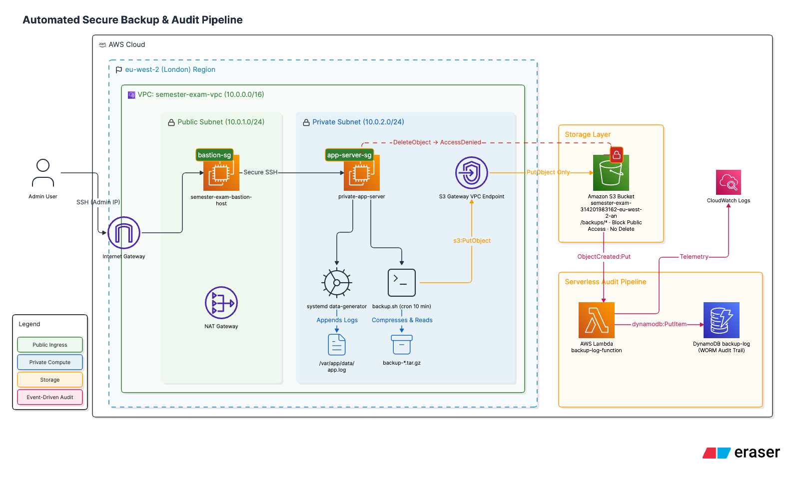
---

## AWS Services & Responsibilities

| Service | Component | Security & Functional Role |
| :--- | :--- | :--- |
| **Amazon VPC** | `semester-exam-vpc` | Network boundary isolating public edge compute from private workloads (`10.0.0.0/16`). |
| **Amazon EC2** | `semester-exam-bastion-host` | Bastion jump-box allowing SSH access strictly from authorized IP. |
| **Amazon EC2** | `private-app-server` | Private workload executing log generation and scheduled backup archives. |
| **Amazon S3** | Backup Bucket | Durable object store with Block Public Access enabled and write-only IAM policies. |
| **AWS IAM** | EC2 & Lambda Roles | Enforces Least Privilege access principles across compute and serverless components. |
| **AWS Lambda** | `backup-log-function` | Python 3.x event-driven function extracting S3 upload metadata. |
| **Amazon DynamoDB** | `backup-log` | On-Demand NoSQL table storing tamper-resistant audit logs of every backup event. |

---

## Step-by-Step Implementation Walkthrough

### Step 1: Custom VPC Infrastructure
A dual-tier network architecture was deployed in region `eu-west-2` (London) consisting of a public subnet for ingress proxies, a private subnet for internal workloads, an Internet Gateway (IGW), a NAT Gateway for outbound egress, and route tables.

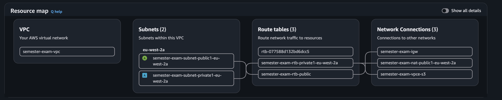
*Figure 1: AWS VPC Resource Map confirming `semester-exam-vpc` topology, route tables, Internet Gateway, NAT Gateway, and S3 VPC Endpoint.*

---

### Step 2: Bastion Host Setup (Public Subnet)
An EC2 `t3.micro` instance (`semester-exam-bastion-host`) was launched in the public subnet (`semester-exam-subnet-public1-eu-west-2a`). Its security group (`bastion-sg`) restricts SSH inbound access (TCP port 22) strictly to the administrator's `/32` IP address.

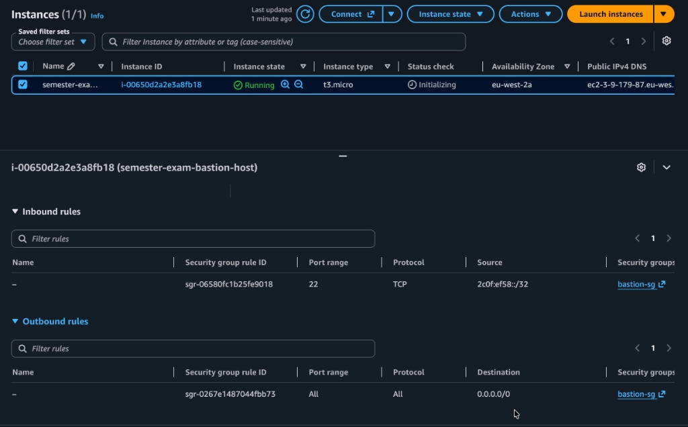
*Figure 2: Bastion host instance details and inbound security group rules enforcing single-IP SSH access.*

---

### Step 3: Private Application Server Setup
An EC2 `t3.micro` instance (`private-app-server`) was deployed in the isolated private subnet (`semester-exam-subnet-private1-eu-west-2a`) without a public IP address. Its security group (`app-server-sg`) allows SSH inbound traffic exclusively from the Bastion host's security group ID (`sg-034ff049ff309f961`).

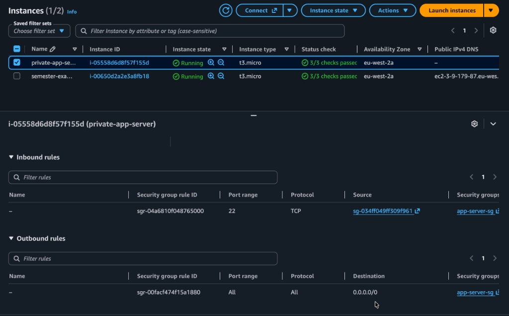
*Figure 3: Private application server configuration showing strict inbound SSH scoping from the Bastion Security Group.*

---

### Step 4: Secure S3 Backup Bucket
An S3 bucket (`semester-exam-314201983162-eu-west-2-an`) was created with global **Block Public Access** settings enabled on all 4 control parameters.

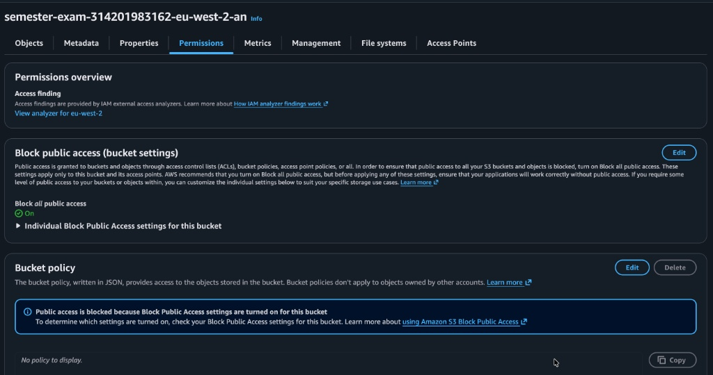
*Figure 4: S3 Bucket permissions dashboard displaying active Block Public Access settings.*

---

### Step 5: IAM Security & Write-Only Enforcement
An IAM policy was attached to the application server's execution role (`write-backups-semester-exam`). The policy explicitly grants `s3:PutObject` for `arn:aws:s3:::semester-exam-314201983162-eu-west-2-an/backups/*` while omitting delete permissions.

```json
{
  "Version": "2012-10-17",
  "Statement": [
    {
      "Effect": "Allow",
      "Action": "s3:PutObject",
      "Resource": "arn:aws:s3:::semester-exam-314201983162-eu-west-2-an/backups/*"
    }
  ]
}
```

#### Immutability & Permission Verification
To prove write-only capabilities, an upload test was performed from the private server command line:

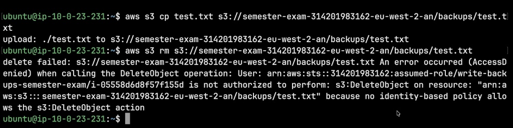
*Figure 5: Terminal verification showing successful file upload (`aws s3 cp`) and explicit `AccessDenied` error on deletion (`aws s3 rm`).*

---

### Step 6: Daemon Log Generator Setup
A shell script `/home/ubuntu/data-generator.sh` was written to simulate application activity by generating ISO-8601 timestamps into `/var/app/data/app.log` every 30 seconds.

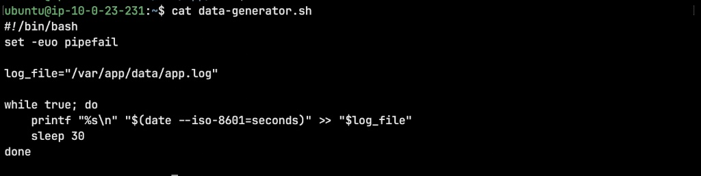
*Figure 6: `data-generator.sh` script implementation utilizing `set -euo pipefail` and ISO-8601 timestamp formatting.*

A `systemd` service unit `/etc/systemd/system/data-generator.service` was created and enabled to guarantee execution on boot and immediate restart upon unexpected exit.

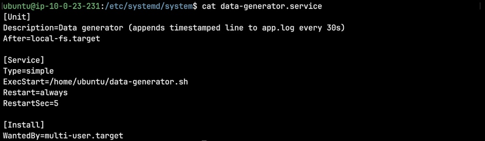
*Figure 7: Systemd service unit definition configured with `Restart=always` and `WantedBy=multi-user.target`.*

---

### Step 7: Automated Backup Script & Cron Schedule
A robust backup script `/home/ubuntu/backup.sh` was developed to compress `/var/app/data`, upload the compressed archive to S3 with a timestamped file name (`backup-YYYY-MM-DD-HHMM.tar.gz`), log execution telemetry to `/var/log/backup.log`, and purge local temporary files upon successful upload.

The script was scheduled in `crontab` to run every 10 minutes using absolute executable paths.

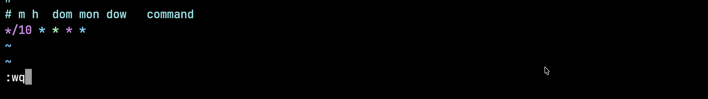
*Figure 8: Crontab configuration in terminal.*

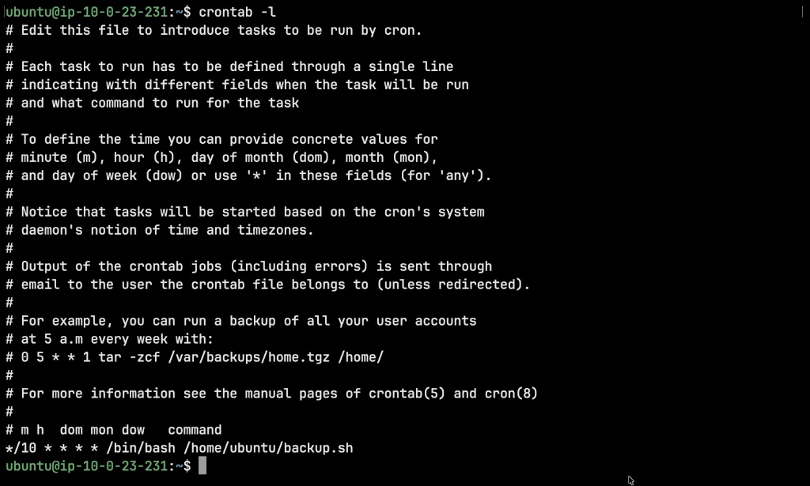
*Figure 9: Active crontab list confirming 10-minute backup interval schedule (`*/10 * * * *`).*

---

### Step 8: Audit Log Datastore (DynamoDB)
An Amazon DynamoDB table (`backup-log`) was provisioned in `eu-west-2` using **On-Demand** capacity mode with a String partition key (`backup_id`).

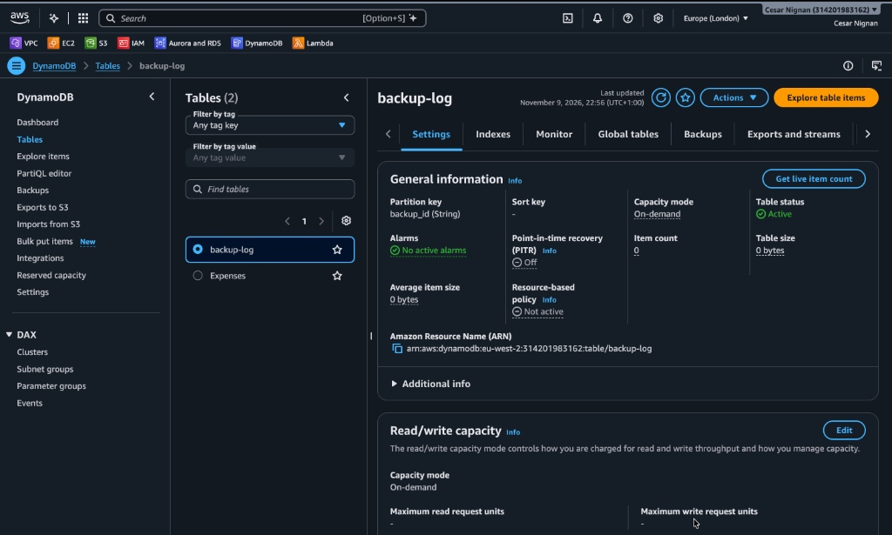
*Figure 10: Active DynamoDB `backup-log` table details in AWS Console.*

---

### Step 9: Event-Driven Audit Pipeline (Lambda & Triggers)
An AWS Lambda function (`backup-log-function`) written in Python 3.x was configured with an S3 Event Notification trigger listening for `s3:ObjectCreated:Put` events under the `backups/` prefix.

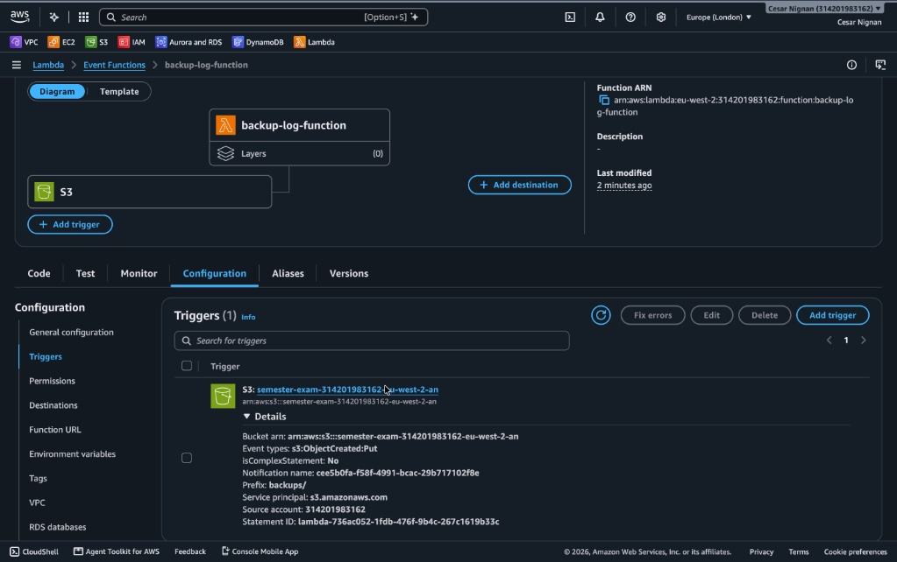
*Figure 11: Lambda function overview displaying active S3 trigger integration.*

#### Least-Privilege Lambda IAM Policy
The Lambda execution role (`backup-log-function-role`) is granted only `dynamodb:PutItem` permissions on the `backup-log` table resource, alongside CloudWatch Logs permissions.

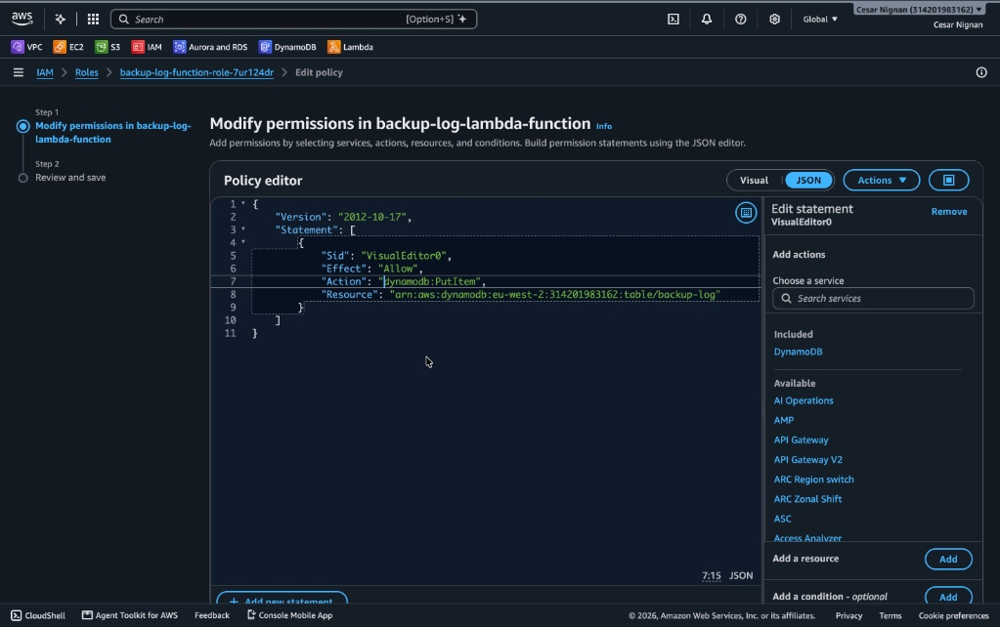
*Figure 12: IAM JSON Policy Editor confirming least-privilege `dynamodb:PutItem` permission.*

---

## Security & Compliance Analysis

1. **Defense-in-Depth Network Isolation:** The application server cannot be accessed from the public internet. All ingress must hop through the hardened Bastion host.
2. **Least Privilege Identity Access Management (IAM):** Neither the application server nor the Lambda function possesses administrative permissions. The app server is strictly restricted to `s3:PutObject`.
3. **Data Immutability Guarantee:** If an adversary compromises the EC2 instance, any attempt to run `aws s3 rm` or overwrite audit logs fails with `AccessDenied`.
4. **Serverless Auditing:** The generation of the audit log is decoupled from the application server. The app server cannot falsify, tamper with, or delete entries in DynamoDB.

---

## Verification & Test Results
* **Instance Access:** SSH connection successfully established to Private App Server strictly through the Bastion Host.
* **Service Resilience:** `systemd` daemon verified actively writing logs every 30 seconds to `/var/app/data/app.log`.
* **Immutability Test:** Executed `aws s3 rm` against uploaded backup object — API returned explicit `AccessDenied`.
* **Automated Trigger Test:** Cron-triggered backup archives automatically invoked `backup-log-function`, creating corresponding audit items in DynamoDB.

---

## Cost Considerations
Estimated monthly costs for low-traffic demo usage are minimal (~$5.00 - $10.00 / month). For detailed pricing breakdowns, free-tier limits, and billing safety guidelines, consult [COST.md](./COST.md).

---

## Cleanup & Teardown Guide
To avoid ongoing charges, destroy resources in the following order:
1. **DynamoDB:** Delete table `backup-log`.
2. **AWS Lambda:** Delete function `backup-log-function` and its IAM execution role.
3. **Amazon S3:** Empty all objects in bucket `semester-exam-314201983162-eu-west-2-an`, then delete the bucket.
4. **Amazon EC2:** Terminate `private-app-server` and `semester-exam-bastion-host`.
5. **Amazon VPC:** Delete NAT Gateway, release Elastic IP, delete Internet Gateway, subnets, and `semester-exam-vpc`.

---

## 📁 Repository Structure
```text
aws-secure-backup-pipeline/
├── README.md
├── COST.md
├── .gitignore
├── architecture/
│   └── architecture.png
├── screenshots/
│   ├── step-01-vpc-resource-map.png
│   ├── step-02-bastion-host-sg.png
│   ├── step-03-private-app-server-sg.png
│   ├── step-04-s3-bucket-permissions.png
│   ├── step-05-iam-policy-access-denied-test.png
│   ├── step-06a-data-generator-script.png
│   ├── step-06b-systemd-service.png
│   ├── step-07a-crontab-configuration.png
│   ├── step-07b-crontab-schedule.png
│   ├── step-08-dynamodb-table.png
│   ├── step-09a-lambda-s3-trigger.png
│   └── step-09b-lambda-iam-policy.png
└── src/
    ├── backup.sh
    ├── data-generator.sh
    ├── data-generator.service
    └── lambda_function.py
```
